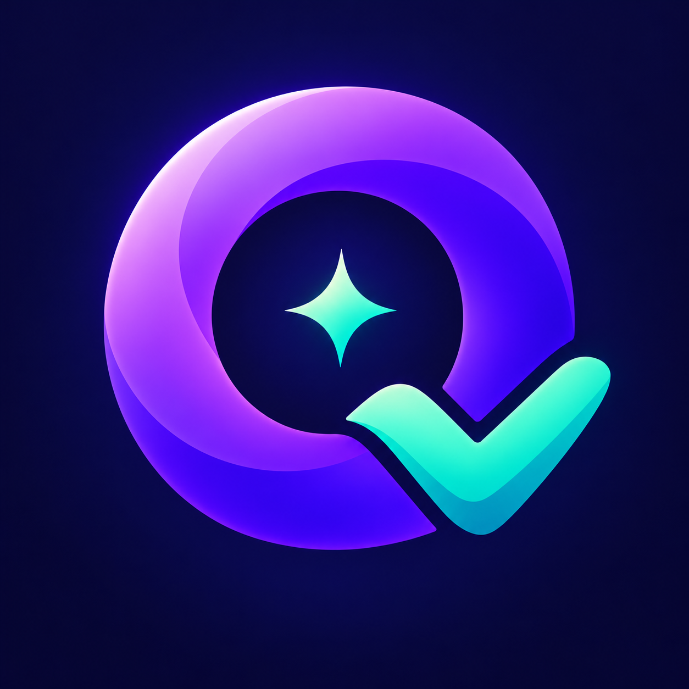
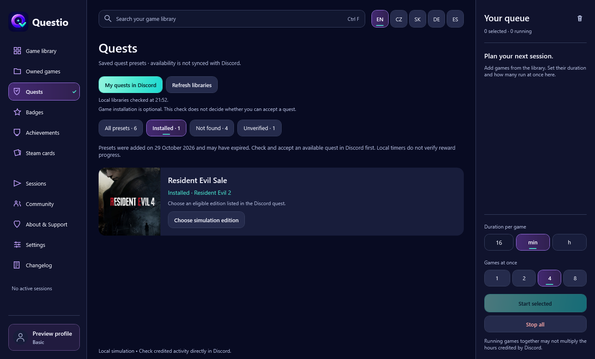

<p align="center"></p>

# Questio

[](STATUS.md)

<!-- package-details -->
**Version:** 4.0 Beta · **Last updated:** 2026-11-03 20:52 UTC · [Changelog](CHANGELOG.md)
<!-- /package-details -->

A free Windows app that checks which quest games are installed, shows read-only achievements and opens real Steam games from your card collection. Sign in with Discord and join the Questio community to use it. Choose English, Czech, Slovak, German or Spanish at the top.

**Created by Tecka.exe and Nouně · Supported by NodeVault and NF Scripts**

[Download releases](../../releases) · [Join Discord](https://discord.gg/ERzQaHgPeV) · [Česky](docs/README.cs.md) · [Known limitations](KNOWN_ISSUES.md)



## Download and start

1. Open **Releases** and download `Questio-4.0-Beta-Windows.zip`. GitHub's automatic **Source code** archives contain this documentation, not the application.
2. Extract the ZIP to a writable folder. Run `Questio.exe` as your normal Windows user; administrator access is not required.
3. Sign in on the official Discord page. Questio requests your profile and membership/role information for its community.
4. If needed, join the [community](https://discord.gg/ERzQaHgPeV), complete its membership screening and choose **Check membership**.
5. Start on Quests. Check your local Steam and Epic installations, then open Discord for your personal offers and rewards.

Requires Windows with .NET Framework 4.8 and internet access for Discord sign-in/membership checks. The release is portable and currently unsigned. The packaged verification report describes actual testing; a clean second-PC test has not yet been recorded.

The release ZIP includes `SHA256.txt` for the extracted EXE. A separate release `SHA256SUMS.txt` identifies the download ZIP. Compare a downloaded ZIP with PowerShell:

```powershell
Get-FileHash -LiteralPath .\Questio-4.0-Beta-Windows.zip -Algorithm SHA256
```

## New in 4.0

- **Quests:** filter saved presets by the local installation check. The matched edition is shown; helper processes do not count as an installation. Personal quests and their progress stay in Discord.
- **Discord startup:** opt in to a skippable countdown. Questio opens a signed registered client or requests a normal restart. If the client would minimize to the tray or cannot be verified, it does not force a restart.
- **Owned games:** view visible Steam titles by SteamID or import Valve’s GetOwnedGames result; for Epic, open the launcher library or import a Legendary library export. Games need not be installed.
- **Achievements:** look up explicit results for a public Steam profile and supported game. For Epic, open the official profile or preview and save a clearly labeled personal list on this PC.
- **Steam cards:** see remaining drops on your Steam badge page. Choose one verified installation and click to launch it through Steam. Nothing is farmed automatically.

## Other features

- Search a large catalog of game profiles, with game artwork and saved selections.
- Run up to eight local sessions, with a queue, duration controls and local history.
- Browse saved quest presets and manually plan game-count/playtime goals.
- Sign in using Discord OAuth, show your avatar and check community membership.
- Recognize Owner, Developer, Supporter and Basic community roles; all members keep the same free stable tools. Owner and Developer have a local Admin workspace with individual unlock phrases.
- Switch between five languages and export a small diagnostic report when you choose.

**Activity sessions run helper processes, not the actual games.** Local timers do not prove that Discord detected a game or credited a quest, badge or playtime. Quest presets are saved examples, not a live list of your quests. FC 27 and badge credit remain unverified. This release stays **Beta**; see [known limitations](KNOWN_ISSUES.md).

## Accounts and privacy

Questio does not ask for your Discord password, email, messages or Discord-client token. Optional remembered OAuth credentials are protected by Windows DPAPI for your Windows account. Your data stays under `%LOCALAPPDATA%\PlaytimeDesktop` for compatibility with older versions.

Joining the server uses a visible invite. The app does not automatically join or move people to servers. Read [Privacy](PRIVACY.md) for storage, sign-out and diagnostic-export details.

## Support and feedback

Report reproducible bugs through the issue form or the community. Include the app version, Windows version, steps and expected/actual result. **Settings → Export diagnostics** writes an allowlisted JSON report locally. Review it before attaching it; do not post account credentials or your AppData folder.

[PayPal support](https://paypal.me/NouneNunu) is optional. Questio remains free, and a payment does not automatically assign a Discord role.

NodeVault focuses on ComfyUI workflows; NF Scripts focuses on FiveM scripts. [Credits and asset attribution](THIRD_PARTY_NOTICES.md).

## Updates and repository contents

Download later versions from Releases, close Questio and replace the extracted app. Preferences and optional remembered sign-in are kept separately. Keep the prior ZIP if you want to revert. No automatic updater is included.

This is a **public distribution and support repository**. Application source, owner tools, credentials and build workspace are not published here. The app is not offered as open-source software. [Changelog](CHANGELOG.md) · [Support](SUPPORT.md) · [Security reporting](SECURITY.md)
